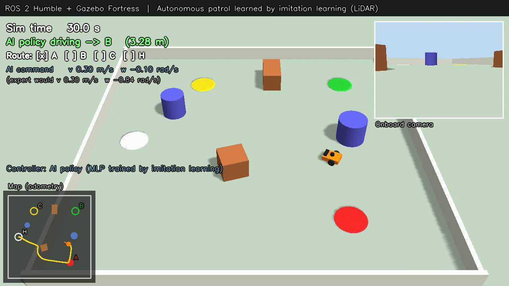

# 模倣学習で自律巡回する差動二輪ロボット (ROS 2 Humble + Gazebo Fortress)

Physical AI 応用編1 最終課題。
LiDAR とオドメトリだけを入力に、**ニューラルネットの方策 (AI) が速度指令を出して**、
障害物を避けながら A → B → C → ホーム を巡回する。

方策は、手で設計した障害物回避 (ポテンシャル法) を「お手本」とした **模倣学習 (Behavior Cloning)** で学習し、
さらに **DAgger** でお手本から外れた状態での立て直しを学ばせた。
第5回講義の「ROS でデータ収集 → 変換 → 学習 → デプロイ → デバッグ」の流れを、差動二輪の移動ロボットに当てはめている。



## 結果

評価ルート A→B→C→H (障害物 4 個) での比較 (録画なしで同じ条件で実行):

| 制御器 | 完走した試行 | 所要時間 | 走行距離 | 障害物への最接近 |
|---|---|---|---|---|
| お手本 (ポテンシャル法) | 1 / 1 | 69.3 s | 20.3 m | 0.45 m |
| 模倣学習 (BC) のみ | 2 / 3 | 71.7〜100.7 s | 17.5〜20.4 m | 0.20〜0.23 m |
| BC + DAgger 1 反復 | **3 / 3** | 69.2〜71.6 s | 19.9〜20.5 m | 0.22〜0.24 m |

- BC のみの方策は、C→H の区間で円柱に近づきすぎた状態から抜け出せず (並進 0・旋回 0 を出力) 時間切れになることがあった。
  お手本のデータには「障害物にほぼ接した状態」が含まれない (共変量シフト) うえ、
  そこでは左右どちらに回ってもよい (多峰性) ため、平均として「回らない」を学んでしまったと考えられる。
- DAgger で方策自身が訪れた状態にお手本のラベルを付けて追加学習すると、すべての試行で完走した。

## 仕組み

```
            ┌──────────── Gazebo (Fortress) ────────────┐
            │ diffbot: DiffDrive / 2D LiDAR / カメラ     │
            └──────┬──────────────▲─────────────────────┘
          /scan /odom             │ /cmd_vel
            (ros_gz_bridge)       │
            ┌──────▼──────────────┴─────┐
            │ patrol_node               │  controller:=expert … ポテンシャル法 (お手本)
            │  観測 o (39次元) → 方策 π   │  controller:=policy … 学習した MLP (AI)
            │  /expert_cmd (お手本の指令)│ ← 学習ラベル / 比較用に常に配信
            └───────────────────────────┘
```

| 段階 | 内容 | コード |
|---|---|---|
| 1. 収集 | お手本がランダムな目標 12 個を回る様子を `ros2 bag record` で記録 (6 run)。半分は実行指令にだけ時間相関ノイズを加え、ずれた状態からの立て直しも記録 (DART) | `launch/collect.launch.py`, `patrol_node.py` |
| 2. 変換 | 非同期のトピックを 10 Hz の時刻列に直前値保持でそろえ、(観測, 行動) の組に変換。時間切れのエピソードは除外 | `rosbag2dataset.py` |
| 3. 学習 | MLP 39→256→256→2 (ReLU, 出力 tanh)、MSE、Adam。エピソード単位で 8:2 に分割し、検証誤差最小のモデルを採用 | `train_bc.py` |
| 4. デバッグ | 検証エピソードでお手本の行動と方策の推論を比較 (MAE, R²) | `debug_policy.py` |
| 5. デプロイ | 重みを npz にして numpy だけで 20 Hz 推論 (実行側に PyTorch 不要) | `features.py`, `patrol_node.py` |
| 6. DAgger | 学習した方策にランダムな目標を走らせ、お手本のラベル付きで記録 (4 run)。全データで学習し直す | `setup/run_dagger.sh` |

観測 o: LiDAR 360 本を 10° ごとの 36 セクタの最小距離 (3 m で正規化) + 目標までの距離 + 目標方向の sin, cos
行動 a: 並進速度 / 0.35 m/s, 角速度 / 1.5 rad/s

## 動かし方 (Ubuntu 22.04 / WSL2)

```bash
sudo bash setup/install_ros2_humble.sh      # ROS 2 Humble + Gazebo Fortress
sudo bash setup/install_ai_deps.sh          # PyTorch (CPU) + matplotlib

bash setup/run_pipeline.sh                  # 収集 → 変換 → 学習 → デバッグ → 評価 → 録画
bash setup/run_dagger.sh collect 0 1 2 3    # DAgger 収集
bash setup/run_dagger.sh train              # 全データで学習し直す
bash setup/evaluate.sh policy ~/checkpoints/patrol_bc_dagger/policy.npz 3
bash setup/record_ai_demo.sh                # DAgger 後の方策の走行を録画 → output/patrol_ai_demo.mp4

# 学習済みの重みをそのまま使って GUI で見る
ros2 launch diffbot_task patrol.launch.py controller:=policy \
    model_path:=$(pwd)/output/ai_results/dagger/policy.npz gui:=true record:=false
```

WSL2 では Gazebo の既定の描画エンジン ogre2 が異常終了したため、`ogre` + ソフトウェア描画 (`LIBGL_ALWAYS_SOFTWARE=1`) を既定にしている。

## ファイル構成

```
ros2_ws/src/diffbot_task/
  worlds/patrol_world.sdf      ワールドとロボット (差動二輪 + 2D LiDAR + カメラ)
  config/bridge.yaml           ROS 2 ⇔ Gazebo のトピック対応
  launch/patrol.launch.py      巡回 (expert / policy) + 録画
  launch/collect.launch.py     デモ収集 / DAgger 収集 (rosbag2)
  launch/teleop.launch.py      キー操作 (参考にしたサンプルの構成)
  diffbot_task/patrol_node.py  巡回ノード (お手本 / 学習した方策)
  diffbot_task/features.py     観測・行動の定義、numpy 推論
  diffbot_task/rosbag2dataset.py, train_bc.py, debug_policy.py
  diffbot_task/video_recorder.py  俯瞰カメラ + 状態表示 + ミニマップの録画
setup/                         環境構築・実行スクリプト
output/ai_results/             学習済み重み、学習曲線、デバッグ結果、評価結果
```

## 参考

- ROS2とGazeboの連携によるロボット操作 (最終課題サンプル) https://qiita.com/N622/items/9d89f77d85d9da0af29e
  — 差動二輪 + DiffDrive + ros_gz_bridge + キー操作の構成をベースにした
- Physical AI 応用編1 第5回 講義資料 (ROS によるデータ収集と模倣学習)
- S. Ross et al., "A Reduction of Imitation Learning and Structured Prediction to No-Regret Online Learning" (DAgger), AISTATS 2011
- M. Laskey et al., "DART: Noise Injection for Robust Imitation Learning", CoRL 2017

## License

MIT
